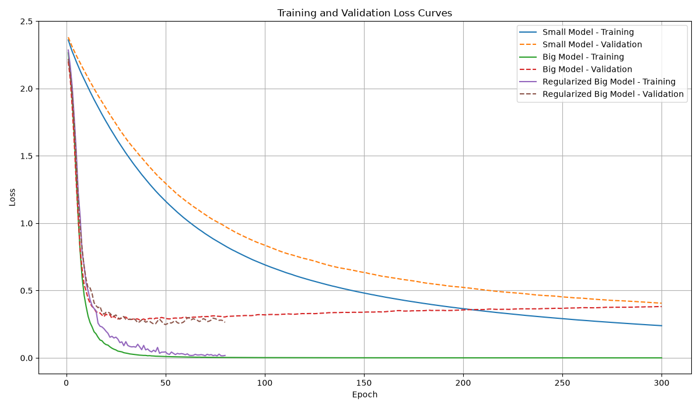

# Courier Digit Recognition

A deep learning project to recognize handwritten digits for a courier company's pincode-reading task.

## Project Overview

The goal of this project is to train neural networks to recognize handwritten digits using a limited amount of labelled data.

### Project Challenge

We have only 200 labelled training images. The challenge is to train models effectively and use training and validation loss curves to identify underfitting and overfitting.

## Dataset

This project uses the `load_digits` dataset from Scikit-learn.

- Total images: 1,797
- Image size: 8 × 8 pixels
- Input features: 64 pixels per image
- Pixel values scaled to the range 0–1

### Dataset Split

| Dataset | Images |
|---|---:|
| Training | 200 |
| Validation | 798 |
| Testing | 799 |
| **Total** | **1,797** |

A fixed random seed (`42`) is used for reproducibility.

## Project Phases

### Phase 1 — Project Setup

- Created the project directory.
- Configured a Python virtual environment.
- Installed the required libraries.
- Initialized the Git repository.
- Created and pushed the GitHub repository.

### Phase 2 — Data Preparation

- Loaded the Scikit-learn digits dataset.
- Scaled pixel values to the range 0–1.
- Split the dataset into training, validation, and testing sets.
- Used a fixed random seed (42).
- Saved the processed datasets as NumPy `.npy` files.

### Phase 3 — Model Development

- Implemented Small Model with one linear layer.
- Implemented Big Model with two hidden layers containing 256 neurons each.
- Implemented Regularized Big Model with Dropout (0.3).
- Configured weight decay (0.05) for the Regularized Big Model.
- Configured early stopping with a patience of 30 epochs.
- Tested all three models using a sample input batch.
- Verified that each model produces an output shape of `(4, 10)`.

### Phase 4 — Model Training

- Developed one common training loop for all three models.
- Trained all three models for up to 300 epochs.
- Used CrossEntropyLoss as the loss function.
- Used AdamW as the optimizer.
- Recorded training and validation loss after every epoch.
- Saved training history in `results/training_history.csv`.
- Saved the best checkpoint for each model.
- Implemented early stopping for the Regularized Big Model.
- Generated training and validation loss curves in `results/curves.png`.

#### Training Results

| Model | Completed Epochs |
|---|---:|
| Small Model | 300 |
| Big Model | 300 |
| Regularized Big Model | 80 |
| **Total Records** | **680** |

- Best validation loss: 0.247271
- Best epoch: 50
- Early stopping: Epoch 80
- Early stopping patience: 30 epochs

### Phase 5 — Learning Curves

- Plotted Small Model training and validation loss curves.
- Plotted Big Model training and validation loss curves.
- Plotted Regularized Big Model training and validation loss curves.
- Compared training and validation loss for all three models.
- Displayed all six curves together in one combined figure.
- Used solid lines for training loss and dashed lines for validation loss.
- Saved the final visualization as `results/curves.png`.

#### Learning Curve Analysis

- **Small Model:** Underfitting was observed.
- **Big Model:** Overfitting was observed because training loss became very low while validation loss remained higher.
- **Regularized Big Model:** Regularization helped improve validation performance. Training stopped at epoch 80, with the best validation loss at epoch 50.

#### Learning Curves Diagram



### Phase 6 — Model Evaluation

#### Evaluation Steps

- Loaded the best checkpoints of all three models.
- Loaded the test dataset.
- Generated predictions using each trained model.
- Calculated test accuracy for all three models.
- Retrieved final training loss from training history.
- Calculated best validation loss and its corresponding epoch.
- Created a final model comparison table.
- Saved evaluation results to `results/evaluation_results.csv`.

#### Final Evaluation Results

| Model | Final Training Loss | Best Validation Loss | Best Epoch | Test Accuracy |
|---|---:|---:|---:|---:|
| Small Model | 0.239137 | 0.406256 | 300 | 91.36% |
| Big Model | 0.000174 | 0.281864 | 40 | 90.74% |
| Regularized Big Model | 0.018162 | 0.247271 | 50 | **92.24%** |

#### Results Analysis

- Small Model achieved 91.36% test accuracy.
- Big Model achieved 90.74% test accuracy.
- Regularized Big Model achieved the highest test accuracy of 92.24%.
- Regularized Big Model also achieved the lowest validation loss of 0.247271.
- The Regularized Big Model demonstrated the best overall performance among the three experiments.

#### Evaluation Output

- `results/evaluation_results.csv`

## Phase 7 — Final Decision

### 1. Best Model Selection

The **Regularized Big Model** was selected as the final model because it achieved the highest test accuracy of **92.24%** among all three models.

### 2. Why Did the Small Model Underfit?

- The Small Model contains only one linear layer.
- Its architecture has limited learning capacity.
- It could not learn complex patterns effectively.
- Its training loss was 0.239137 and validation loss was 0.406256.

Therefore, the Small Model showed underfitting because its architecture was too simple for the task.

### 3. Why Did the Big Model Overfit?

- The Big Model contains two hidden layers with 256 neurons each.
- It learned the training data extremely well.
- Its training loss decreased to 0.000174.
- However, its validation loss was 0.281864.

The large difference between training and validation loss indicates overfitting. The model learned the training data better than it generalized to unseen data.

### 4. Why Was the Regularized Big Model Selected?

- Used Dropout with a rate of 0.3.
- Applied weight decay of 0.05.
- Used early stopping with a patience of 30 epochs.
- Achieved the lowest validation loss of 0.247271.
- Achieved the highest test accuracy of 92.24%.

Regularization helped control overfitting and improved generalization.

### 5. Final Decision

The Regularized Big Model is selected for shipping because it achieved the best overall evaluation results.

**Final Statement:**

The Regularized Big Model ships with 92.24% test accuracy, and the most valuable next improvement would be collecting more labelled images of real courier pincodes to evaluate and improve performance on real-world data.

## Project Structure

```text
courier-digit-recognition/
├── .venv/
├── data/
│   ├── X_train.npy
│   ├── y_train.npy
│   ├── X_val.npy
│   ├── y_val.npy
│   ├── X_test.npy
│   └── y_test.npy
├── models/
│   ├── small_model.pth
│   ├── big_model.pth
│   └── regularized_big_model.pth
├── results/
│   ├── curves.png
│   ├── training_history.csv
│   └── evaluation_results.csv
├── src/
│   ├── prepare_data.py
│   ├── models.py
│   ├── training_config.py
│   ├── train.py
│   └── evaluate.py
├── .gitignore
├── README.md
└── requirements.txt
```

## Installation and Setup

The following steps describe how to set up and run the project on Windows using PowerShell.

### 1. Clone the GitHub Repository

```powershell
git clone <your-repository-url>
```

### 2. Open the Project Directory

```powershell
cd courier-digit-recognition
```

### 3. Create a Python Virtual Environment

```powershell
python -m venv .venv
```

### 4. Activate the Virtual Environment

```powershell
.\.venv\Scripts\Activate.ps1
```

### 5. Upgrade pip

```powershell
python -m pip install --upgrade pip
```

### 6. Install Required Dependencies

```powershell
pip install -r requirements.txt
```

### 7. Verify Installed Libraries

```powershell
pip list
```

## Running the Project

Run the following commands from the project root directory with the virtual environment activated.

### Step 1 — Data Preparation

```powershell
python -m src.prepare_data
```

This loads the dataset, normalizes the pixel values, splits the data, and saves the processed `.npy` files.

### Step 2 — Model Training

```powershell
python -m src.train
```

This trains all three models, saves their best checkpoints, records training history, and generates the learning curves.

### Step 3 — Model Evaluation

```powershell
python -m src.evaluate
```

This loads the saved checkpoints, evaluates all three models on the test dataset, calculates test accuracy, and generates the final comparison table.

## Technologies Used

- Python
- PyTorch
- NumPy
- Pandas
- Scikit-learn
- Matplotlib
- Seaborn

## Final Project Status

**Project Status:** Completed

**Selected Model:** Regularized Big Model

**Test Accuracy:** 92.24%

**Best Validation Loss:** 0.247271